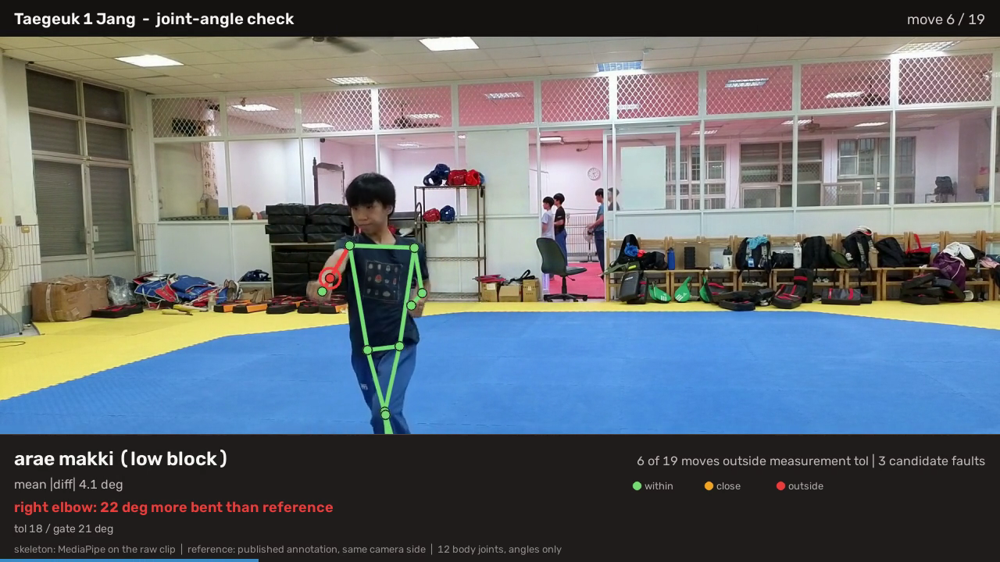
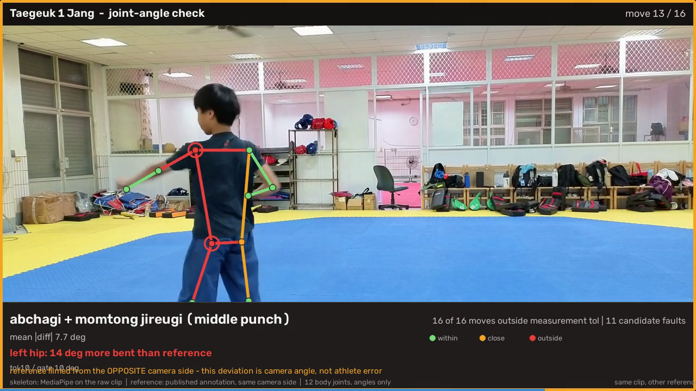

# Poomsae Coach

A joint-angle form checker for Taekwondo poomsae that **refuses to call a deviation a fault
until the deviation is bigger than the athlete's own habit**.

It turns two camera views of the same form into numbered movement cards, each with a
plain-language sentence a coach can read out loud — and it separates *this is your style*
from *this is a mistake*, because those two things look identical to a naive angle threshold.

[](media/demo_sameview.mp4)

▶ [**demo_sameview.mp4**](media/demo_sameview.mp4) — 25.6 s, 768 frames, 6.0 MB. Click the still
to play it on GitHub. Every number burned into that overlay is read from the same JSON the
coach card is generated from, so the video cannot drift from the card.

---

**Live page:** <https://ahmadalzaro1.github.io/poomsae-coach/> — the same evidence rendered from the committed artifacts by `scripts/build_site.py`; CI deploys it, so it cannot drift.

## The problem this repo actually solves

An angle tolerance has two completely different jobs, and they need two different numbers:

| job | question it answers | what a wrong answer costs |
|---|---|---|
| **measurement** | "are these two readings of the same movement telling me the same thing?" | you report noise as if it were motion |
| **attribution** | "is this move a mistake by this athlete?" | you tell every athlete their body is wrong |

This project started with one number doing both jobs: **18°** for the elbow. It was derived
honestly — the pooled per-move p95 disagreement between two independent pose estimators on the
same frames was 17.6°, so 18° is where a difference stops being measurable. Then it was used as
the fault threshold, and it produced a card that flagged 9 of 171 joint cells on a recording
compared **against itself**.

The reason shows up in two measurements of human variation:

| | elbow | knee | torso |
|---|---:|---:|---:|
| within-take repeats (same athlete, same camera, n ≥ 6) | **6.5 – 8.0° sd** | 0.7° | 0.3° |
| cross-athlete (94 players, 100-phase trajectory) | **32.7° mean / 68.5° worst** | 4.7° / 11.3° | — |
| tolerance that was in force | **18°** | 10° | 5° |
| ratio | 2.3× the repeat spread, **0.55× the cross-athlete spread** | 14× | 17× |

18° is a sane *measurement* bound and an indefensible *fault* bound: half the distance between
two different people. Changing the number would have been guessing. The fix was to change what
gets compared.

## The one idea

Each athlete is judged against their own form, not against the reference performer:

```
offset   = median(delta) over this athlete's own moves   -> style / build, reported, never a fault
residual = delta - offset                                -> only a residual may become a fault

scale    = max(1.4826 * MAD(residual), floor)
           floor = the two pose estimators' measured disagreement on this cell,
                   raised to the measured repeat spread where one exists

fault  iff  |residual| > tolerance                     (the measurement tolerance, unchanged)
        and |residual| > 2.5 * scale                   (not systematic inconsistency)
        and |residual| > this cell's estimator band    (bigger than the estimators' own argument)
```

The third condition was not designed, it was **demanded by the clean arm**: three of the first
five "faults" on a self-comparison were smaller than the two pose models' disagreement on
identical frames (residual −45.2° against a ±68.2° band). Reporting those would have been
reporting the tool.

The effective threshold is therefore reported, never hidden —
`max(tolerance, 2.5 × floor)`: **21.0° for the right elbow**, 18.1° left, 10.0° knee/hip,
12.0° shoulder, 5.0° torso.

## What it found in the sample form (Taegeuk 1, same-view)

| move | t | technique | measurement flag | own offset | residual | gate | verdict |
|---|---:|---|---:|---:|---:|---:|---|
| 6 | 6.2 s | arae makki (low block) | right elbow **21.5°** | 0.4° | **21.1°** | 21.0° | candidate fault — clears by 0.1° |
| 13 | 14.97 s | eolgul makki (high block) | left elbow **22.1°** | 0.1° | **22.0°** | 18.1° | candidate fault |

The 0.1° margin on move 6 is stated, not smoothed: at that size the finding is real but fragile,
and a coach should read it as "check this one", not "this is wrong".

The opposite-camera pair shows why the split matters. Comparing the same take against a
reference filmed from the other side of the room gives a mean deviation of 12.5° and flags every
move — but 9 of the 11 remaining candidates are absorbed as **this athlete's own offset under
that camera geometry**, and the card labels them that way instead of blaming the athlete.



▶ [**demo_crossview.mp4**](media/demo_crossview.mp4) — same clip, reference from the opposite side.

## Certified behaviour, not claimed behaviour

Every row below is re-derived from committed artifacts by `python3 scripts/verify_claims.py`
(73/73 checks; no dataset, no models, no network).

| arm | old gate (raw `|delta| > tol`) | self-referenced layer |
|---|---:|---|
| clean arm — student **is** the reference recording, no fault exists | 9 cells | **3 candidates = 1.75% of 171** (disclosed as the detector's floor) |
| style arm — systematic **+20° elbow / −15° knee** | 39 cells | **0 findings beyond the clean floor**, 37 cells labelled style, offsets recovered at **+20.4° / −15.0°** against +20/−15 injected |
| injections at **0.5×** effective threshold | — | **0.000 detection** (refuses) |
| injections at **0.9×** effective threshold | — | **0.000 detection** (refuses) |
| injections at **1.05×** effective threshold | — | **1.000 of judgeable cells**; 12 of 171 band-blind; 0.9298 if band-blind cells count as misses |
| injections at **1.05×** onto a *measured* base | — | 0.6038 of judgeable cells — the artefact base consumes part of the tolerance |

That last row is the honest one. Injection detection is only clean on a **zero base**, where the
injected angle is the only signal. On top of the real artefact base the same injection is detected
~60% of the time, because a pre-existing 8° and an injected 21° do not add up to a detectable 29°.
An earlier version of this benchmark reported the measured-base number as sensitivity; it was
measuring addition.

On 752 expert-labelled performances from 94 other players (8-class, 5-fold grouped by player):
**0.9801** accuracy against controls of **0.9735** (1-nearest-neighbour), **0.9258** (single frame
only) and **0.1276** (shuffled labels). The margin over 1-NN is 0.7 points — this dataset is close
to linearly separable, and the report says so instead of claiming a model win.

## What this does not claim

- **It is not a scoring system.** WT poomsae scoring includes presentation, speed, power, rhythm
  and spirit; nothing here measures those.
- **No public dataset carries expert fault labels.** The only fault ground truth here is synthetic
  injection — a detector test, not a validity study.
- **18° is a measurement tolerance, not a fault threshold.** The effective gate is 21.0° for the
  right elbow, printed next to the tolerance wherever both appear.
- **A genuine fault ceiling needs a second athlete.** In this harness the student *is* the
  reference recording, so the 1.75% floor is annotation/pose artefact, and it lives in moves 15–16
  where the annotation and the pose model disagree by up to 74°.
- **3D did not help.** Realigning a frontal reference against a lateral take reduced the deviation
  range to 0.867× of the 2D case with no gain in signal-to-noise; `out/crossview_3d.json` returns
  the verdict "no benefit".
- **The learned gate was refused.** A classifier on the same features reached AUC 0.712 at an 86.5%
  false-positive rate; a threshold without meaning is worse than a stated one.

## Reproduce it

Two levels, and the cheap one is the one that matters for trust.

**1. Check the numbers (no dataset, no models, ~1 s):**

```bash
git clone https://github.com/ahmadalzaro1/poomsae-coach && cd poomsae-coach
python3 scripts/verify_claims.py --show
# -> 73/73 README claims re-derived from committed artifacts
```

**2. Re-run the whole pipeline (dataset + pose models):**

```bash
python3 -m venv .venv && .venv/bin/pip install -r requirements.txt
.venv/bin/python scripts/fetch_data.py     # CC-BY dataset, see docs/DATA.md
.venv/bin/python scripts/fetch_models.py   # MediaPipe .task weights
.venv/bin/bash run_all.sh                  # 23 steps, ends "all steps ok - 0 failures"
```

`run_all.sh` fails loudly when the data or models are missing rather than producing an empty
result, and every one of the 23 steps prints its own banner. Step 1 dominates a cold run: it
re-derives poses for all 16 clips with **both** estimators (that pairwise disagreement *is* the
tolerance), and caches them to `out/elbow_signal/`, so a second run is orders of magnitude
cheaper.

## Guardrails that fail loudly

Two ways this pipeline could lie quietly, both closed:

| failure | naive behaviour | this repo |
|---|---|---|
| `out/tolerance_override.json` missing, so the gate would run on the built-in 25° default instead of the measured 18° | prints a line, exits 0, publishes a different verdict | `core.TOLERANCE_MEASURED = False`; `self_reference` **refuses with exit 2** and names step 1. (Both branches are tested: the gate with the override, and the refusal without it.) |
| dataset or model weights absent | writes an empty card | `run_all.sh` refuses before step 1 and points at the fetch script |

The first one is not hypothetical — it is how this repo was broken once, by shipping the artifacts
without the derived tolerance they depend on, and it was caught by re-running step 14 in the fresh
checkout rather than by reading the code.

## Repo map

```
poomsae/            the pipeline — one module per claim, so every number has an author
  core.py           hip-centred, torso-scaled joint angles; DTW alignment; tolerances
  self_reference.py offsets, residuals, the three-condition gate, and the benchmark
  uncertainty.py    estimator-swap bands: which cells are judgeable at all
  repeatability.py  within-take repeat spread (the noise floor)
  between_athlete.py 94 athletes, 100-phase trajectory spread (the human floor)
  make_card.py      the coach card — table plus "why a deviation is not a fault"
  render_video.py   the overlay video; reads thresholds from the card, never its own table
  build_demo_page.py the interactive page (out/demo.html)
out/                committed artifacts: cards, JSON, coach card, demo page, pose CSV
media/              the two demo videos + stills
docs/               METHOD, RESULTS, LIMITATIONS, DATA, PRIOR-ART
scripts/            verify_claims.py (the trust gate), check_links.py, fetch_data.py, fetch_models.py
.github/workflows/  CI: re-derive every claim, check every link, refuse committed corpora
run_all.sh          23 steps, start to finish
```

## Prior art, and where this sits

| work | method | what it reports | gap this repo addresses |
|---|---|---|---|
| Hoang & Ahn 2023, *An Evaluation Method of Taekwondo Poomsae Performance* (JICCE) | Rodrigues-vector pose + DTW against a motion-captured champion | mean/min/max cost per performer | no fault threshold, no noise floor, no ground-truth check |
| Ang et al. 2025, *SyncScore* (APSIPA) | ViTPose landmarks + SVR on inter-person distance | R² = 0.3915 vs expert sync scores | measures synchronisation between two people, not correctness |
| `Doankt/poomsae-score-py` | scoring prototype | GPL-3.0, 2019 | no published validation |
| `Jiwoo-Jung-AIS/Offline_Poomsae_Trainer` | MMPose + Gradio, 14 movements | offline demo | no published accuracy, no threshold provenance |
| `SriMed/sr_eval_tkd_v2` | Detectron + VideoPose3D + DTW | course project | no evaluation protocol |

The gap in all five is the same, and it is not a modelling gap: **nobody publishes the number
below which a difference is not real.** That number is what this repo is about, which is why
`verify_claims.py` ships as the first thing to run.

## Licence and attribution

- **Code:** MIT — see [LICENSE](LICENSE).
- **Sample video:** derived from the CC-BY 4.0 dual-view Taegeuk 1–8 dataset
  ([10.17632/bjy7vr4xkt.1](https://doi.org/10.17632/bjy7vr4xkt.1)); exact attribution and
  derivation in [ATTRIBUTION.md](ATTRIBUTION.md).
- **The 94-athlete labelled dataset is NOT in this repo.** Its upstream repository carries no
  licence file, so only the *numbers computed from it* are published (`out/eight_class.json`,
  `out/between_athlete.json`). Redistribution needs written permission from its authors.
- **Model weights (46 MB of MediaPipe `.task` files) are not committed** — `scripts/fetch_models.py`
  pulls them.
